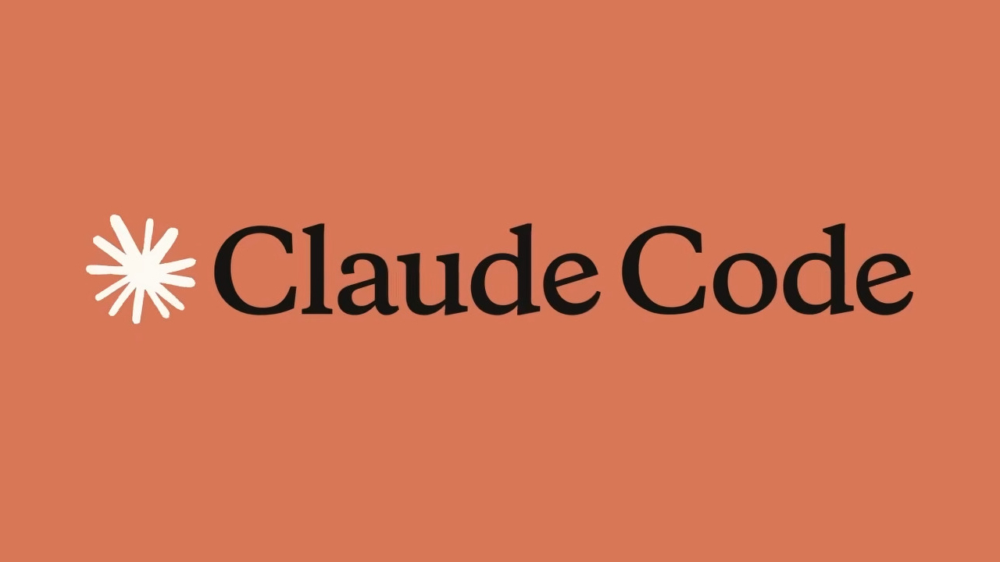

# 💫 About Me:
Hi, I’m MAREDJ Anes, a Software Engineering student at the University of Malaya. I like programming and want to get better at building software that holds up.  From Software Maintenance and Evolution, I want to learn how real systems are maintained and adapted when requirements change. Refactoring, reengineering and program comprehension interest me most. My goal is to leave able to pick up an existing codebase, understand it, and fix it without breaking everything.

## 🌐 Socials:
 
# 📊 GitHub Stats:
 
 

---

